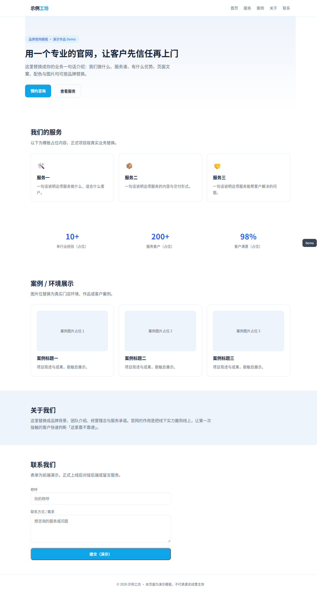
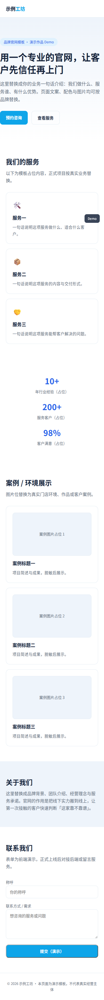

# 品牌官网 Demo（示例工坊）

> 演示作品 Demo · 用于展示官网 / 落地页交付能力，非生产环境项目。

## 项目简介

面向本地门店、工作室、小团队的品牌官网模板：用一屏专业的首页把业务、服务、案例和联系方式讲清楚，客户在电脑和手机上打开都能正常浏览，先建立信任再上门咨询。页面文案、配色、图片均可按真实品牌替换。

## 在线预览

- 在线地址：【部署后填写 Gitee Pages / 独立站链接】
- 本地入口：`demo-website.html`
- 截图：
  - 桌面整页：
  - 手机端：

## 功能列表

- 顶部吸顶导航，锚点平滑跳转到首页 / 服务 / 案例 / 关于 / 联系；
- 首屏 Banner：标语 + 业务一句话介绍 + 两个行动按钮（预约咨询、查看服务）；
- 三栏服务卡片（图标 + 标题 + 一句话说明）；
- 数据统计条（年限 / 客户数 / 满意度，均为占位数据）；
- 案例 / 环境展示三卡片（图片占位位，可替换为真实案例图）；
- 关于我们区块；
- 联系 / 留言表单（称呼、联系方式与需求，前端演示提交，不发送到后端）；
- 响应式适配：桌面三栏、手机单栏；窄屏隐藏顶部导航链接。

## 技术栈

- 前端：原生 HTML + 内联 CSS + 原生 JavaScript（无框架、无构建工具）；
- 后端：暂无，表单为前端 mock 提交；
- 数据：页面文案与卡片为占位内容，可替换为真实业务信息；
- 字体：思源黑体 VF（CDN `@font-face` 引入，系统字体回退）；
- 部署：静态托管即可（Gitee Pages / GitHub Pages / 自有服务器 / 对象存储）。

## 目录结构

```
portfolio/
├── index.html            # 作品集门面站（入口）
└── demo-website.html     # 本 Demo 单文件入口，样式与脚本内联
```

## 本地运行

1. 克隆仓库到本地；
2. 直接用浏览器打开 `demo-website.html`，或起一个本地静态服务预览；
3. 无需后端与数据库即可查看演示效果。

## 可扩展 / 可对接

- 联系表单可对接真实后端接口或第三方留言表单（如表单助手、企微 / 邮箱通知）；
- 可新增产品详情页、新闻动态、在线地图、导航外链等页面；
- 可按品牌替换 Logo、主配色、图片与文案；
- 可扩展多语言版本、SEO 元信息、统计埋点。

## 免责说明

本仓库为演示作品，页面数据均为 mock，不代表真实经营主体；不包含任何前东家或客户的真实业务数据与机密源码。如有定制开发需求，请通过站内私信沟通。
