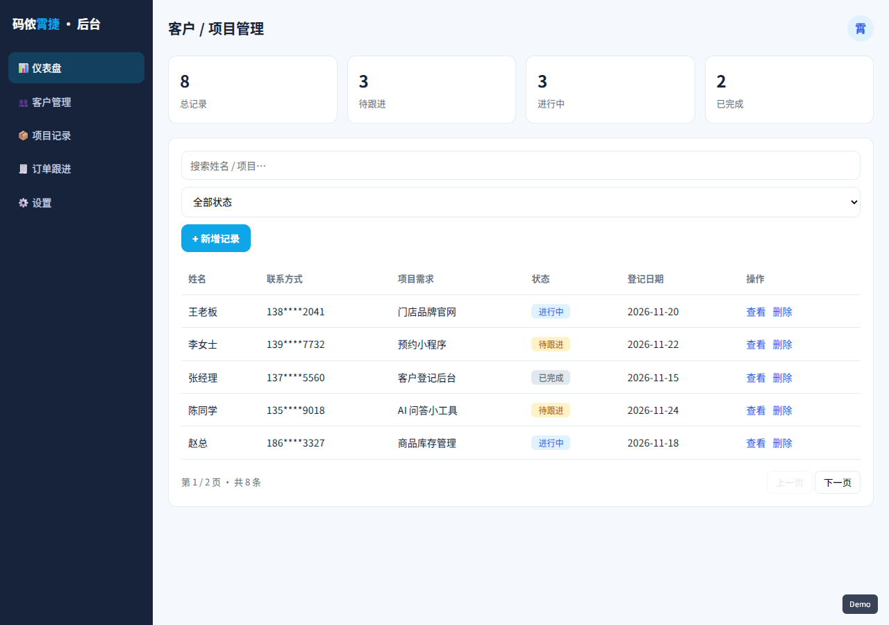
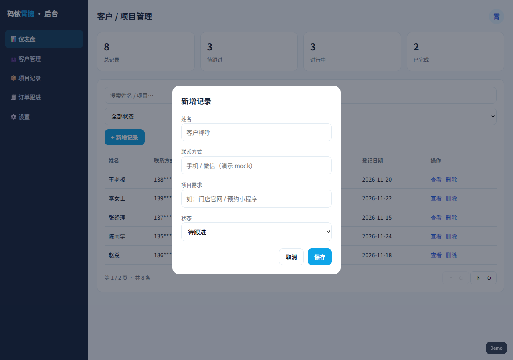

# 通用业务管理后台 Demo

> 演示作品 Demo · 用于展示管理系统 / CRUD 后台交付能力，非生产环境项目。

## 项目简介

面向小团队、商家、工作室的通用后台模板：客户 / 项目登记、状态跟进、搜索筛选、分页查看、新增记录一屏搞定。适合客户管理、订单跟进、库存登记、内部审批等业务场景，可按实际需求换字段、换流程。

## 在线预览

- 在线地址：https://acxj.github.io/code-portfolio/demo-admin.html
- 作品集门面站：https://acxj.github.io/code-portfolio/
- 本地入口：`demo-admin.html`
- 截图：
  - 后台首页（统计卡 + 列表）：
  - 新增记录弹窗：

## 功能列表

- 左侧深色侧边栏菜单：仪表盘、客户管理、项目记录、订单跟进、设置（入口占位）；
- 顶部标题栏与用户头像；
- 四张统计卡片：总记录、待跟进、进行中、已完成，数量随列表数据实时联动；
- 工具栏：按姓名 / 项目关键词搜索、按状态筛选；
- 数据表格：姓名、联系方式、项目需求、状态标签、登记日期、操作；
- 状态标签：待跟进（黄）、进行中（蓝）、已完成（灰）；
- 分页：每页 5 条，上一页 / 下一页，显示当前页与总条数；
- 新增记录弹窗表单：姓名、联系方式、项目需求、状态，姓名必填校验；
- 列表操作：查看（占位）、删除记录；
- 响应式：窄屏隐藏侧边栏，统计卡片两栏排布。

## 技术栈

- 前端：原生 HTML + 内联 CSS + 原生 JavaScript（无框架、无构建工具）；
- 后端：暂无，记录数据为前端内存 mock，刷新后重置；
- 数据：初始 8 条客户 / 项目记录均为虚构 mock，可对接真实后端；
- 字体：思源黑体 VF（CDN `@font-face` 引入，系统字体回退）；
- 部署：静态前端托管；正式项目可搭配后端接口与数据库。

## 目录结构

```
portfolio/
├── index.html            # 作品集门面站（入口）
└── demo-admin.html       # 本 Demo 单文件入口，样式与脚本内联
```

## 本地运行

1. 克隆仓库到本地；
2. 直接用浏览器打开 `demo-admin.html`，或起一个本地静态服务预览；
3. 无需后端与数据库即可查看演示效果。

## 可扩展 / 可对接

- 对接后端接口：登录鉴权、数据增删改查走真实 API，接入数据库；
- 可扩展：数据导出 Excel、状态流转审批、操作日志、权限角色、图表报表；
- 可按业务替换字段：如商品库存、订单、工单、会员、内容管理等；
- 可与前台 H5 / 官网打通：前台提交的预约、留言自动进入后台列表。

## 免责说明

本仓库为演示作品，页面数据均为 mock，联系方式与客户姓名为虚构脱敏示例；不包含任何前东家或客户的真实业务数据与机密源码。如有定制开发需求，请通过站内私信沟通。
