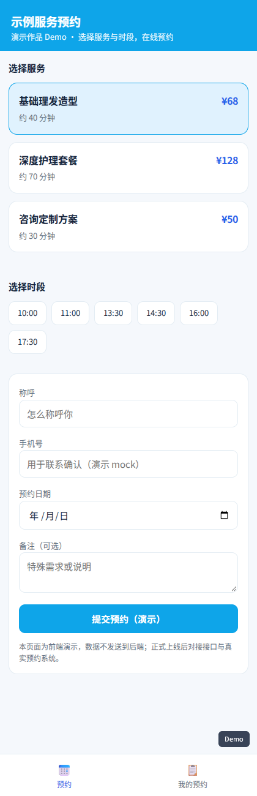
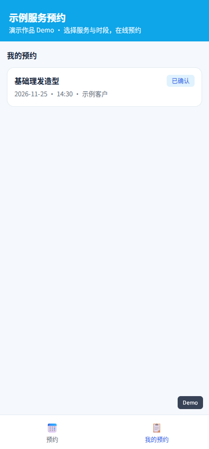

# 服务预约小程序 H5 Demo

> 演示作品 Demo · 用于展示预约类小程序 / H5 交付能力，非生产环境项目。

## 项目简介

面向门店、美业、教育、咨询等需要线上下单预约的业务：客户在手机上选服务、选时段、填信息提交，商家能在"我的预约"里看到登记记录。本 Demo 为手机竖屏 H5 形态，可后续封装为微信小程序 / App 页面。

## 在线预览

- 在线地址：https://acxj.github.io/code-portfolio/demo-booking.html
- 作品集门面站：https://acxj.github.io/code-portfolio/
- 本地入口：`demo-booking.html`
- 截图：
  - 预约首页（选服务 / 时段 / 表单）：
  - 我的预约列表：

## 功能列表

- 手机竖屏容器：桌面预览时居中窄栏，手机上全屏展示；
- 服务列表：名称、时长、价格，点击可选中（mock 三条服务）；
- 时段选择：时间段标签多选一，选中态高亮；
- 预约表单：称呼、手机号、预约日期、备注（可选）；
- 前端校验：未选时段时提示先选时段；提交后写入本地内存的预约列表；
- 底部双 Tab 切换：「预约」「我的预约」；
- 我的预约：展示服务、时段、日期、称呼、备注与状态；无记录时空状态提示；
- 提交成功后自动跳转到"我的预约"查看新登记记录。

## 技术栈

- 前端：原生 HTML + 内联 CSS + 原生 JavaScript（无框架、无构建工具）；
- 后端：暂无，预约数据为前端内存 mock，刷新后重置；
- 数据：服务、时段、初始预约记录均为 mock，可对接真实后端；
- 字体：思源黑体 VF（CDN `@font-face` 引入，系统字体回退）；
- 部署：静态 H5 托管；后续可迁移至小程序框架（原生微信小程序 / uni-app）。

## 目录结构

```
portfolio/
├── index.html            # 作品集门面站（入口）
└── demo-booking.html    # 本 Demo 单文件入口，样式与脚本内联
```

## 本地运行

1. 克隆仓库到本地；
2. 直接用浏览器打开 `demo-booking.html`；建议用浏览器设备模拟（手机视图）查看；
3. 无需后端与数据库即可查看演示效果。

## 可扩展 / 可对接

- 对接后端接口：服务 / 时段从后台读取，预约写入数据库并支持取消、改期；
- 接入短信 / 公众号消息通知，预约成功后提醒客户与商家；
- 可扩展：在线支付、优惠券、会员积分、服务评价、商家端排期日历；
- 可封装为微信小程序或 App 内 WebView 页面。

## 免责说明

本仓库为演示作品，页面数据均为 mock，联系方式与预约记录为虚构；不包含任何前东家或客户的真实业务数据与机密源码。如有定制开发需求，请通过站内私信沟通。
